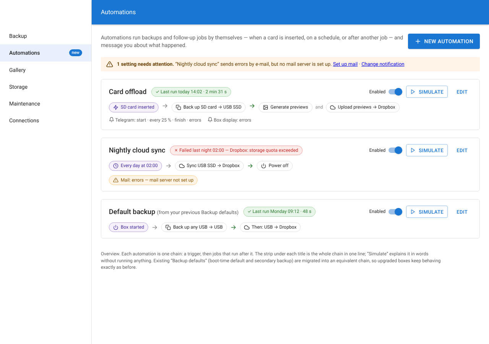
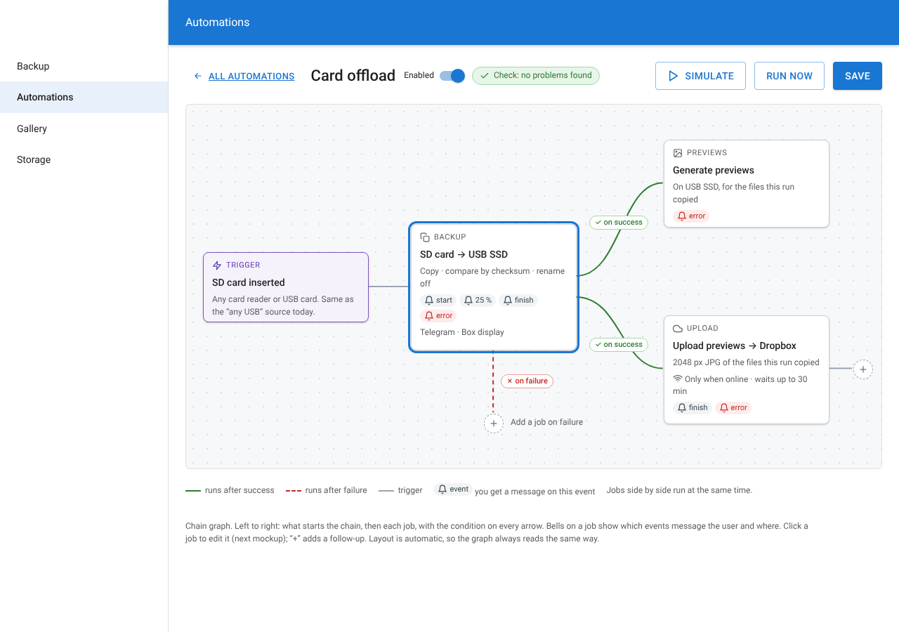
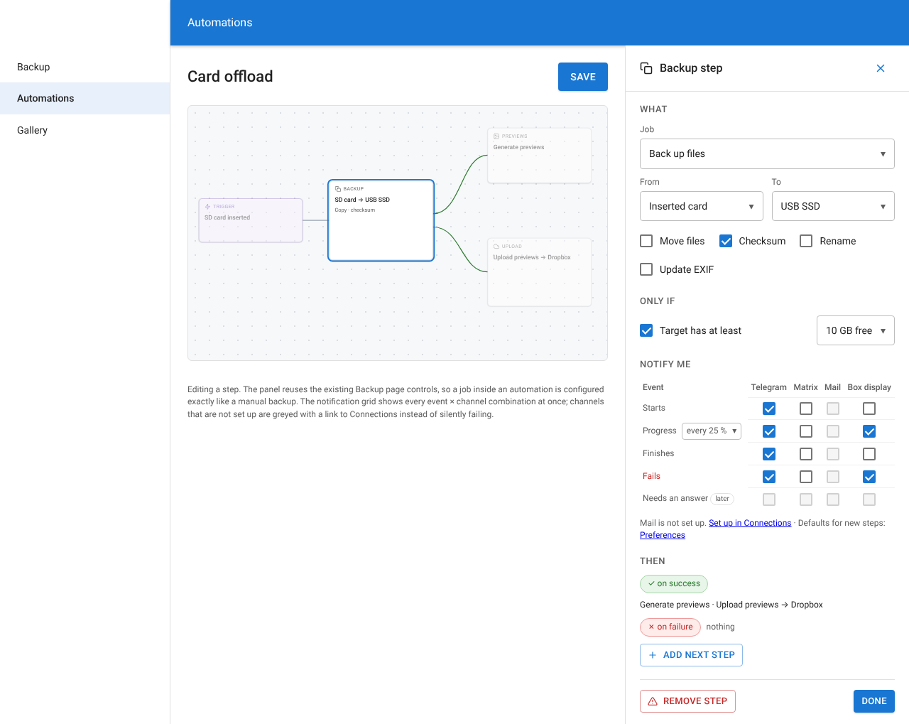
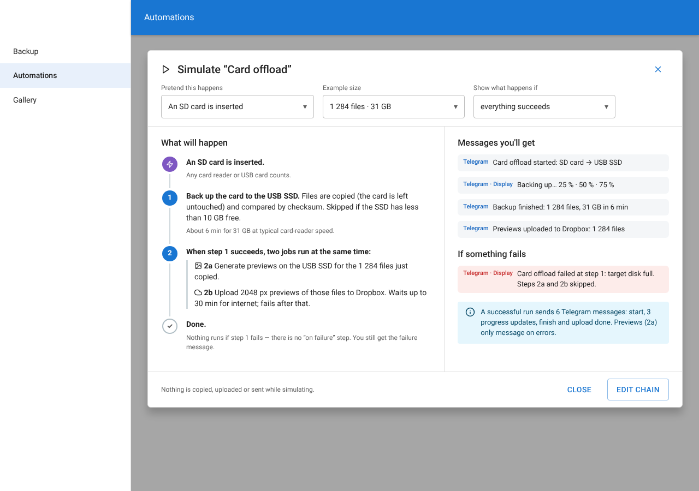
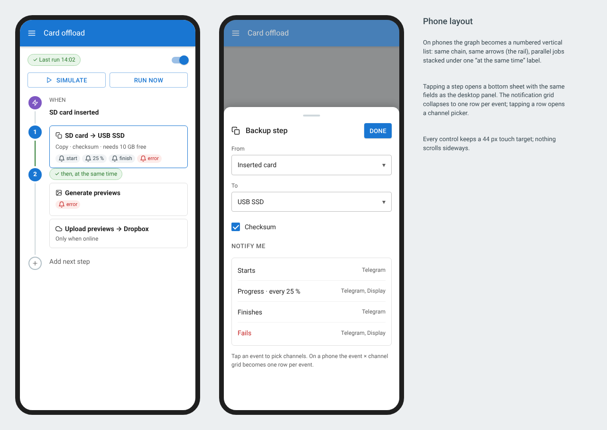
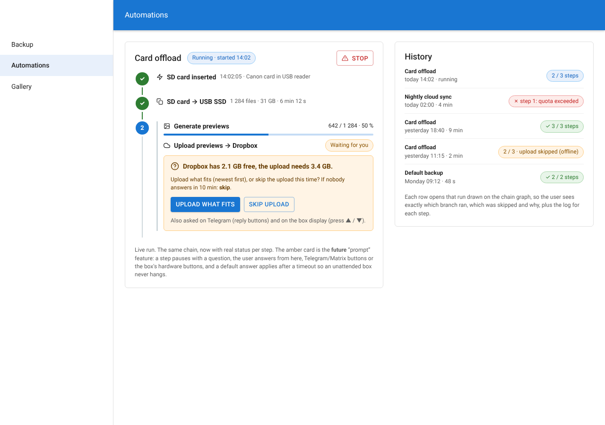

# Backup automation mockups

Static mockups for the `add-backup-automations` proposal. They are drawn in the webapp's MUI light theme so they can be read in context. Each `.png` is rendered from the `.html` file next to it; open the HTML file in a browser to inspect it.

| | |
| --- | --- |
|  | **01 Overview.** One card per automation, with a one-line chain strip, the last run, an enabled switch, and Simulate/Edit buttons. A "needs attention" banner comes from Check. |
|  | **02 Chain graph.** Trigger → jobs, left to right. Edges are labelled ✓ on success / ✗ on failure. Bells show which events send a message. "+" adds a follow-up job. |
|  | **03 Step editor.** *What*, *Only if*, *Notify me* (event × channel grid) and *Then* (follow-up jobs). |
|  | **04 Simulate.** A plain-language walkthrough of what would happen and which messages would be sent. Nothing runs. |
|  | **05 Phone.** The chain as a numbered vertical list, with the step editor as a bottom sheet. |
|  | **06 Live run and history.** Includes the future "needs your answer" prompt. |

To re-render after editing the HTML (from `webapp/`, which has Playwright installed), take a full-page Chromium screenshot of each file at a 1280 px viewport.
